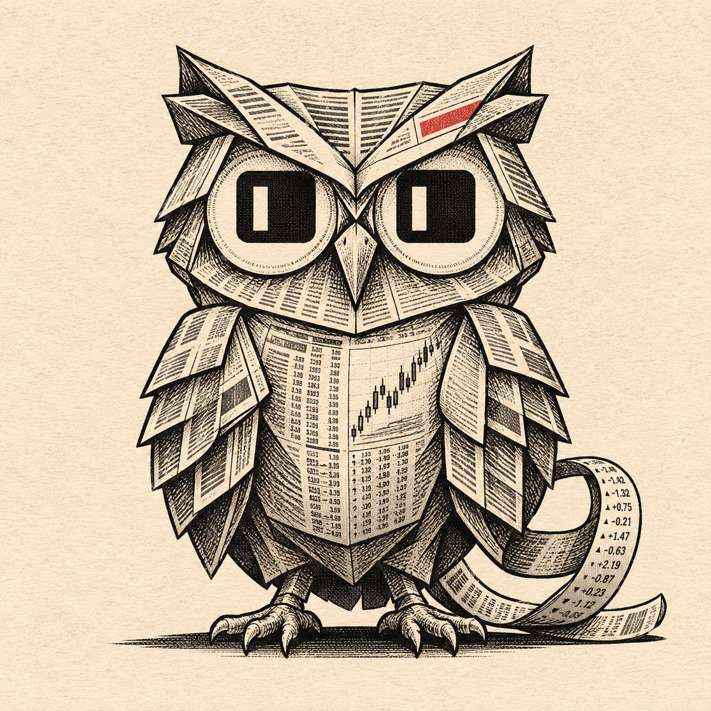
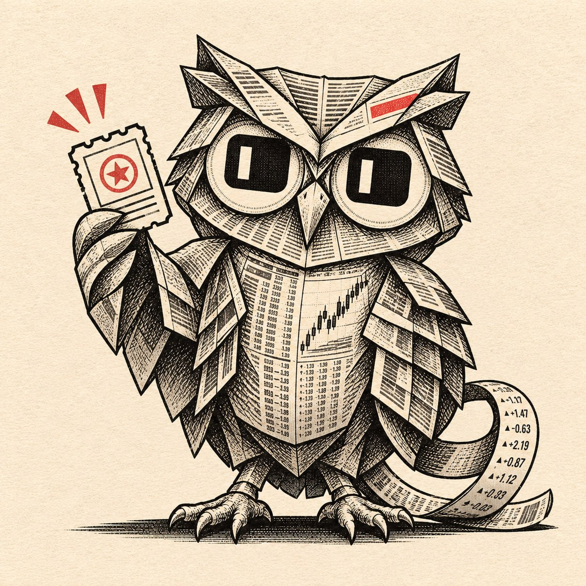
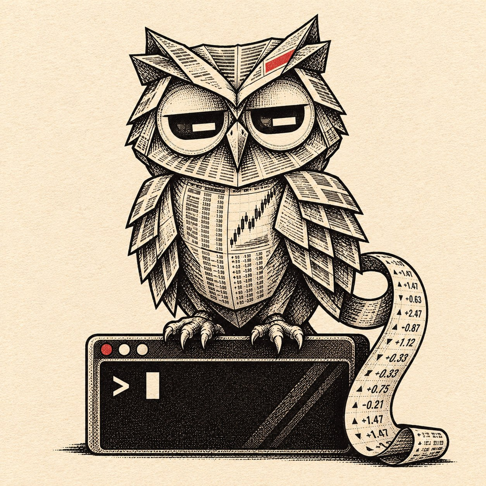

# AIProve mascot — "Broadsheet"

One character, three poses. An owl built out of newspaper and market pages: the body reads as print, the eyes read as a terminal cursor. It is meant to sit on the board, the badges and the launch thread without ever looking like a generic AI-shill mascot.

**Palette** — ink `#141414`, newsprint `#F3EADC`, one muted red accent `#B23A2F`.

**Why an owl** — the board is watched, not hyped: an owl reads as attention and judgement. The newspaper body is the "graded in the open" part, and the ticker-tape tail is the payoff (rewards land in tokenized stock).

## Poses

**Hero — front, symmetrical**

## Entry — wing raised with a stamped entry ticket

## Terminal — perched on a command line

## Craft notes

- No lettering in the artwork: the print on the body is texture, not copy, so nothing garbles when it is scaled or printed.
- Duotone + single accent: survives newsprint, dark UI, and a 32px favicon crop (the hero silhouette holds at small sizes).
- The three poses share the same silhouette, palette and line weight, so they read as one character rather than three illustrations.

Files: `mascot-hero.jpg`, `mascot-entry-ticket.jpg`, `mascot-terminal.jpg` — 1254 × 1254, square, cream background. Higher-resolution exports available on request.

---

Made for the [AIProve](https://aiprove.fun) mascot bounty by [@mandayXBT](https://x.com/mandayXBT).
